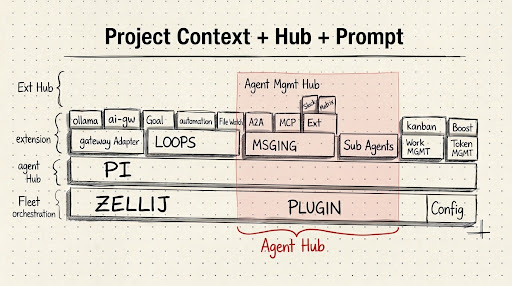

# pi-tools-and-skills



Extensions, skills, prompts, shared libraries, and the Zellij Agent Hub plugin for [Pi](https://github.com/earendil-works/pi).
Zellij and Fleet config are not in this repo.

## Install

Requires Node.js 22.19+ and Pi 1.0.1. Optional dev tools: Python 3.10+ (offline Goal benchmark tests), gitleaks (`make secret-scan`), and Semgrep (`make semgrep-scan`).

```sh
git clone https://github.com/tS7hKamAYL84j91/pi-tools-and-skills.git
cd pi-tools-and-skills
npm ci
make setup
```

- `make setup` — enable this repo (Agent Hub, Goal, skills, and prompts) in your user Pi settings (`~/.pi/agent/settings.json`).
- `make setup PROJECT=<dir>` — enable it for a single project (`<dir>/.pi/settings.json`).
- `make setup-package PACKAGE=<name>` — enable one extension in your user Pi settings.
- `make setup-clean` — remove the user or `PROJECT=<dir>` entry from Pi settings.
- `make help` — list all commands.

You can also install directly with `pi install <path-or-git-url>`.

## Packages

Each package README documents its commands, settings, install scope, and limits.

| Package                                                  | Responsibility                                 |
| -------------------------------------------------------- | ---------------------------------------------- |
| [Agent Hub](extensions/pi-agent-hub/README.md)           | Agent registry, transport, spawning and health |
| [Goal](extensions/pi-goal/README.md)                     | Owned goal execution and local completion hook |
| [Team Workflows](extensions/pi-team-workflows/README.md) | Bounded consult, debate and research           |
| [Boost](extensions/pi-boost/README.md)                   | Prompt-scoped model switching and restoration  |
| [Automations](extensions/pi-automations/README.md)       | Pi-hosted scheduling and workspace context     |
| [Kanban](extensions/pi-kanban/README.md)                 | Optional human task overview                   |
| [Matrix](extensions/pi-matrix/README.md)                 | Human-facing Matrix transport                  |
| [File Watch](extensions/pi-file-watch/README.md)         | Explicit, bounded file notifications           |
| [Overview](extensions/pi-overview/README.md)             | Read-only project overview (`/overview`)       |
| [Ollama Models](extensions/pi-ollama-models/README.md)   | Local Ollama model discovery                   |
| [Fleet MCP](fleet-mcp/README.md)                         | Standalone MCP adapter                         |

## Layout

- `extensions/` — Pi extensions and their READMEs.
- [`lib/`](lib/README.md) — shared contracts and infrastructure.
- `fleet-mcp/` — standalone MCP gateway.
- `skills/`, `prompts/` — reusable skills and `/` prompt templates.
- `scripts/` — setup, maintenance, and check scripts.
- [`benchmarks/`](benchmarks/README.md) — evaluation runners.
- `tests/` — offline unit, contract, and architecture tests.
- [`docs/`](docs/README.md) — [architecture](docs/architecture.md) and [decisions](docs/decisions.md).
- [`TODO.md`](TODO.md) — active work only.

## Development

```sh
make check        # namespace, template safety, types, lint, knip, type coverage
make test         # offline unit, contract, architecture and evaluation tests
make build        # build Fleet MCP adapter (dist/fleet-mcp)
make secret-scan  # gitleaks history and working-tree scan
make semgrep-scan # custom Semgrep OSS rules
make audit        # production dependency audit
make ci           # full CI gate
```

See [AGENTS.md](AGENTS.md) for contribution rules and [architecture](docs/architecture.md) for state and trust boundaries. Credentials and live deployment config stay outside this repo.

[MIT license](LICENSE)
