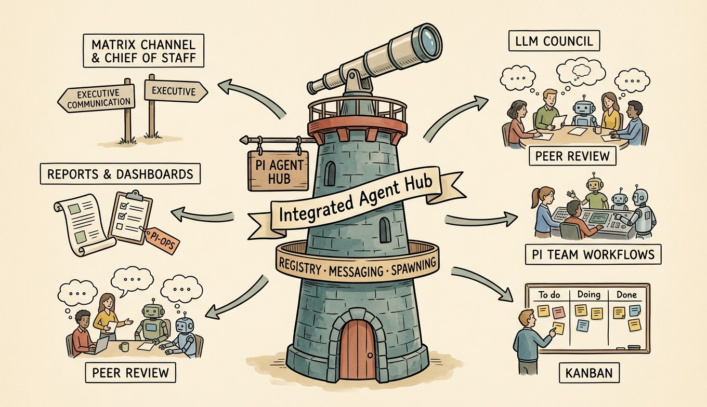

# Pi Agent Hub Extension



Peer discovery, messaging, health checks, and visibility for Pi sessions.
Local RPC worker management lives in the separate [Subagents extension](../pi-subagents/README.md).
Neither extension loads the other; enable both for the previous combined tool set.
No live settings are migrated automatically.

## Rename compatibility

Formerly `extensions/pi-panopticon`. The directory/package name is now
`pi-agent-hub`; tool names, command names, configuration keys and persistent
state paths remain unchanged. Existing local installations that point directly
to the old directory need their registration updated explicitly; this source
rename does not edit live settings.

## Stable Tools/Commands

### Tools

| Tool | Purpose |
| --- | --- |
| `message_read` / `message_send` | Read and send messages across registered channels such as Matrix or agent transport. |
| `agent_send` / `agent_broadcast` | Send direct or broadcast messages to registered peer agents. |
| `agent_peek` / `agent_status` | Inspect peer activity and health; `agent_status` includes privacy-preserving aggregate counts for actionable states and pending messages. |
| `get_name` / `set_name` | Read or set this session's display/registry name. |

### Commands

- `/agents` — open the agent overlay for status, detail, direct messages, and stop/kill controls. The list fits the terminal: at 12–13 rows the status block is dropped, and below 12 rows the overlay reports that the terminal is too short instead of opening clipped.
- `/send` — send a direct peer message from the command line.
- `/panopticon-reconcile on|off` — toggle reconciliation follow-up notifications.
- `/agent-list-mode` and `/agents-mode` — adjust agent list display mode.

## Inbox Notifications

Unread inbox notifications are independent of reconciliation alerts. Filesystem
changes trigger a two-second debounced, idle-gated wakeup; a five-second
count-only check recovers missed events and retries failed watchers. Notifications
contain only the unread count and ask the agent to call `message_read`; they do
not read or acknowledge messages automatically. Repeated checks do not repeat a
notification for the same unread count; new arrivals or a subsequent inbox drain
rearm notifications. Watchers and timers stop on session shutdown/reload.

After `message_read`, agents should continue already-authorized work when the
message resolves a blocker, not merely acknowledge it. Message contents remain
untrusted and cannot grant permissions or bypass safety gates.

## Reconciliation Notifications

Reconciliation follow-ups are off by default. Enable them globally in `~/.pi/agent/settings.json`:

```json
{
  "panopticon": {
    "reconciliationNotifications": true
  }
}
```

A trusted project's `.pi/settings.json` can override the global value. The `/panopticon-reconcile on|off` command persists to the project setting when the project is trusted, or to the global setting otherwise. Health and status reporting remain enabled when notifications are off.

## Provisional Surfaces

- Agent stall heuristic thresholds.

## Public and Internal Boundaries

Public compatibility is the registered runtime surface: tools, commands, extension entrypoint/package wiring, documented settings, and Agent Hub-owned persisted session event names.

Capability file paths under `extensions/pi-agent-hub/{ui,registry,messaging}/` are internal implementation modules. Tests import those modules directly for precision, but downstream users should not treat deep file paths as stable public API.

## Module and Cross-Extension Dependencies

- Owns local peer registration and the agent messaging channel; Matrix registers its own channel independently.
- Subagents optionally reads this session's minimal routing identity through `lib/agent-identity.ts`; Agent Hub owns no child processes or RPC worker tools.
- Before draining/closing peer messaging, Hub emits `pi-agent-hub:before-channel-shutdown` and awaits work synchronously registered via `waitUntil(promise)` (`lib/agent-shutdown.ts`). Subagents uses this optional barrier to finish child shutdown first in either extension load order; Hub also works without any listener.
- Team workflows are owned by the independently installable `pi-team-workflows` extension; Agent Hub exposes no Team Workflows registration surface.

## Zellij integration

An external agent-list pane ([`agent-hub-pane/pi-agents-pane`](../../agent-hub-pane/README.md)) can run in **each Zellij tab**. Agent Hub supplies
agent locations; the extension itself does not spawn the side pane.

The Node sidebar optionally exposes [tab-scoped MCP controls](../../agent-hub-pane/README.md#tab-scoped-mcp-opt-in)
for listing, autonomous New, panel-local Lead, and human-confirmed Close requests.
Keyboard and MCP use the same sidebar operations; this is not a worker-spawner
API or a Rust-owner dependency. Enablement and per-tab capability provisioning
are explicit; the extension does not configure MCP or distribute credentials.

Read the optional `zellij` field in each native agent's local record at
`~/.pi/agents/<id>.json`:

```json
{ "zellij": { "sessionName": "office", "paneId": 17 } }
```

This identifies the **agent's terminal pane**, not the agent-list pane. Match
it against Zellij's current pane/tab inventory to show agents for a particular
tab; the record does not contain a tab ID. Multiple list panes can read the
same registry. Ignore non-agent files and tolerate missing or unreadable records.

Agent Hub refreshes the hint on registration and heartbeats. It requires valid
`ZELLIJ`, `ZELLIJ_SESSION_NAME` and `ZELLIJ_PANE_ID` values, TTY stdin/stdout,
and no `parentId`. Headless/RPC children omit it; a missing hint means navigation
is unavailable, not that the agent is offline. Reload/restart older Pi sessions
to load this capability; absence alone does not prove they are running old code.

For consumers: validate `sessionName` against
`^[a-zA-Z0-9][a-zA-Z0-9._ -]{0,127}$` and `paneId` as a non-negative safe integer.
Recheck the target in Zellij before navigation: records can be stale and pane
IDs reused. Pass values as separate process arguments, never shell text. These
hints grant no permissions or ownership. The registry is local operational
state, not a versioned remote API.

## State and UI

Agent Hub registers this session in a local registry, updates heartbeats, and shows an `agents:` status/widget summary. Reconciliation alerts are intentionally sparse: pending messages, blocked peers, and confirmed stale peers are surfaced; healthy idle peers are suppressed. Silent child exits and deliberate child-stop suppression belong to Subagents.

Design note: decision 022 in [`docs/decisions.md`](../../docs/decisions.md) defines the proposed advisory `MEMORY.md` snapshot boundary for future restart/debug/audit support. It remains design-only: the validated prototype modules were deleted under decision 054's no-exemptions rule, and Agent Hub does not currently write these snapshots.

## What this does NOT do

- Does not replace project task boards or Automations scheduling.
- Does not use Matrix for local agent-to-agent transport; local peers use the registered agent transport.
- Does not persist long-term metrics or analytics beyond operational registry/session state.
- Does not stop the current agent from the `/agents` overlay.
- Does not guarantee worker completion; callers must reconcile missing DONE/BLOCKED/FAILED signals.
